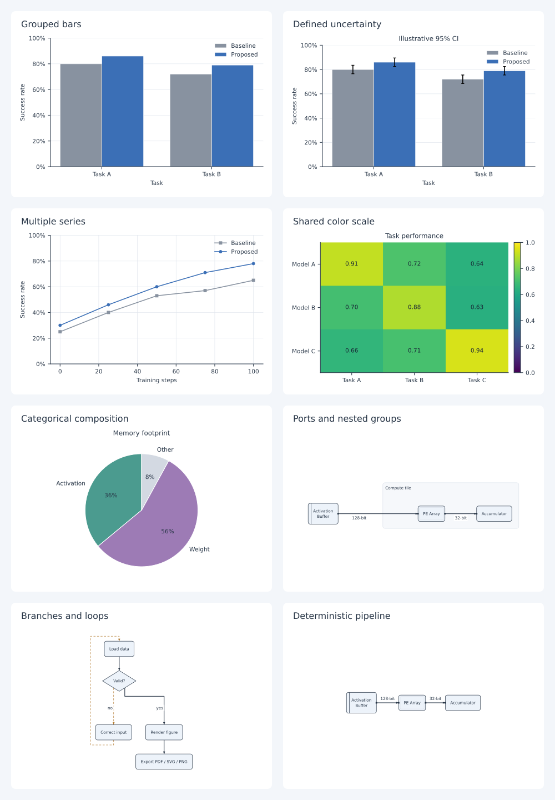

# figdraw

用标准 YAML / JSON / CSV 驱动科研制图。将数据、主题、模板和图实例分开维护，实验更新后批量重新出图，保持字号、语义配色和物理尺寸一致。

当前版本 **0.1.0** 实现统计图与结构图闭环；架构来源见 [项目架构方案](docs/architecture-plan.md)。所有示例数值都是合成数据，不代表实验结论。

## 安装与第一张图

Python ≥ 3.11。使用仓库锁定的环境：

```bash
git clone https://github.com/wolf111108/figdraw.git
cd figdraw
uv sync --locked --extra diagrams
uv run figdraw init bar --output figures/comparison.yaml
uv run figdraw validate figures/comparison.yaml
uv run figdraw render figures/comparison.yaml
```

也支持 `python -m pip install -e '.[diagrams]'`。仅统计图使用 `pip install -e .`，不需要 Node 或 Cairo。

结构图自动布局另需 Node.js ≥ 20：

```bash
npm ci --prefix packages/elk-worker
uv run figdraw architecture examples/architecture.yaml
uv run figdraw build examples/paper.yaml
```

Linux/macOS 的 CairoSVG 转换需要系统 Cairo；缺少时安装 `libcairo2` / `brew install cairo`。`figdraw doctor` 显示后端和 worker 路径。wheel 安装后，按 doctor 输出的 `npm ci --prefix ...` 安装该 worker 的依赖，也可用 `FIGDRAW_ELK_WORKER` 指向已安装的 `worker.cjs`。

默认输出在 **图实例所在目录** 下的 `output/<id>/`。命令行 `--output DIR` 指定输出父目录，按当前工作目录解析。图中的 CSV、主题、项目配色、模板和固定布局路径始终相对图实例文件解析。

## 已实现的图种

| 入口 | 模板 | 支持内容 |
| --- | --- | --- |
| `bar` | `bar.grouped@1.0.0` | 分组柱、绝对上下界误差条、横向版、数值标签 |
| `bar` | `bar.stacked@1.0.0` | 非负堆叠柱；不混用区间或对数轴 |
| `line` | `line.standard@1.0.0` | 多系列、显式排序、线型/marker、缺失点断线 |
| `heatmap` | `heatmap.annotated@1.0.0` | 显式共用色域、发散中心、缺失格遮罩、色条 |
| `pie` | `pie.standard@1.0.0` | 显式归一化、精度、稳定类别色 |
| `flowchart` | `flowchart.standard@1.0.0` | 分支、循环、决策节点、控制连线 |
| `architecture` | `architecture.block@1.0.0` | 嵌套分组、固定侧端口、总线位宽、硬件符号 |



## 输入与定制

```yaml
schema_version: 1
id: comparison
kind: bar
template: bar.grouped@1.0.0
theme: paper@1.0.0
size: {width_mm: 85, height_mm: 55}
data:
  inline:
    - {task: A, method: baseline, score: 0.80}
    - {task: A, method: proposed, score: 0.86}
encoding:
  x: {field: task}
  y: {field: score, unit: ratio, domain: [0, 1], format: percent}
  series: {field: method, order: [baseline, proposed]}
labels: {y: Success rate}
output: {formats: [pdf, svg, png], dpi: 300}
```

- **数据**：内嵌记录或 `data: {source: data.csv, format: csv}`；JSON 外部数据为记录数组。
- **主题**：内置 `paper@1.0.0`、`slides@1.0.0`；复制主题文件，修改 ID 与 token，通过 `theme_file` 引用。固定 mm 尺寸、pt 字号，导出不自动裁边或整体缩小。
- **模板**：版本固定；自定义文件通过 `template_file` 指定，保留已支持的 kind/variant，配置容量、柱组宽度、公开选项默认值。见 [配置手册](docs/configuration.md)。
- **系列样式**：`overrides.series` > `project_style` > 主题映射。未知系列 ID 必须显式指定样式；重排、增删系列不重分配颜色。
- **局部精修**：结构图 `overrides.labels.<稳定 ID>: {dx_pt: 2, dy_pt: -1}`。移动节点必须同时更新端口与相连边的完整布局。

误差条需要 `lower`、`upper` 字段和 `meaning / sample_size / method`；CI 还需 `confidence`。不自动聚合，不将缺失值补成零。对数轴、比例单位、重复键和字段拼写均在绘制前校验。

## 工作流与 Python API

```bash
uv run figdraw bar examples/bar.yaml --output output
uv run figdraw schema --output schemas/figure.schema.json
uv run figdraw preview examples/bar.yaml --watch
uv run figdraw build examples/paper.yaml
```

`preview --watch` 监听图规格及其数据/主题/布局依赖，更新本地输出；打开生成的 PNG/SVG 即可查看。当前不启动网页编辑器。批量构建串行运行，逐图记录成功或失败，失败返回非零状态。

```python
from figdraw import render, render_file

result = render_file("examples/bar.yaml", output_dir="output")
print(result.outputs)
# spec 可以是字典或 Pydantic 模型；相对引用需显式传 base_dir。
# result = render(spec, base_dir="figures", output_dir="output")
```

每次出图同时保存：

- `resolved.yaml`、`theme.yaml`、`template.yaml`：生效配置与样式快照，可独立重绘。
- `data.snapshot.json`、`normalized.json`：源记录与规范化数据；外部数据另保留原始文件。
- `layout.json`：结构图节点、端口、折点、标签及兼容性摘要。
- `manifest.json`：输入/配置/输出摘要、字体名称与文件摘要、依赖/锁文件信息、实际尺寸与诊断。

重绘示例：`figdraw render output/goal_success/resolved.yaml --output reproduced`。字体文件本身不复制，重绘环境仍须安装对应字体；manifest 记录具体字体用于核对。目标是锁定环境下视觉/语义一致，不承诺跨平台逐字节一致。

## 结构图布局

`auto` 使用 elkjs 正交路由，`template` 提供明确的右向/下向单链流水线，`fixed` 加载完整几何快照。fixed 模式检查图结构、标签、字体和节点尺寸，并校验端口及连线端点；不兼容时要求重新布局。

PDF/PNG 结构图使用实际字体轮廓转换，避免 Cairo 字体替换；SVG 默认保留可编辑文字，可通过 `output.text_mode: outline` 转为轮廓。中文需安装含所需字形的字体并在主题中指定，缺字明确报错。统计图支持 Matplotlib 数学文本；结构图标签当前使用普通文字和 Unicode 符号。

## 开发与验证

```bash
uv sync --locked --extra diagrams
npm ci --prefix packages/elk-worker
uv run ruff check .
uv run pytest -q
uv run figdraw build examples/paper.yaml
uv build
```

目录按协议 `specs`、数据 `data`、主题 `themes`、模板 `templates`、统计 `charts`、结构 `diagrams`、导出 `export` 分层。模板注册与绘制代码分开；新增图种需要模型、绘制器、模板、样例和相关验证。

后续扩展：多面板 CompositionSpec、可视化编辑器、Schemdraw 电气示意图、Yosys/netlistsvg 导入。首版没有这些接口的占位承诺。
