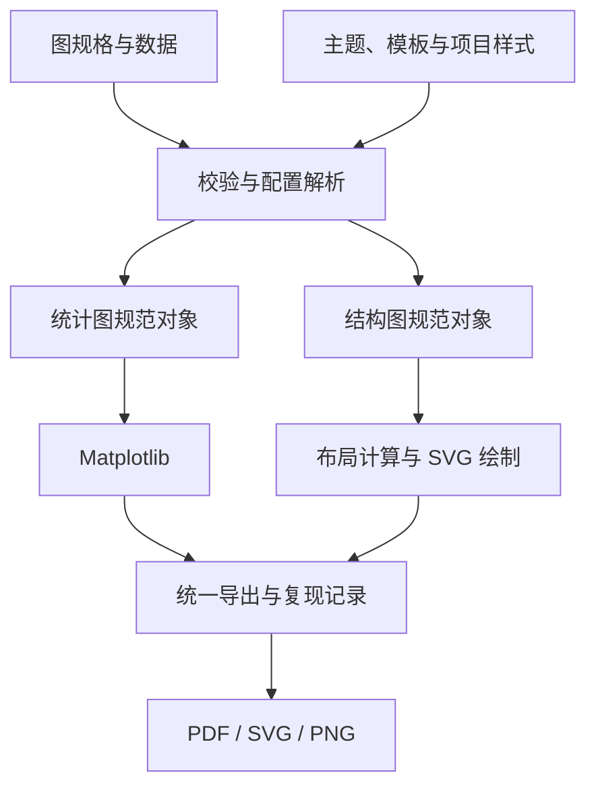

# figdraw 项目架构规划

日期：2026-11-09
状态：架构提案。本文中的配置、接口、目录与命令均为拟议设计，尚未实现；示例数值仅用于说明格式，不代表实验结果。

## 1. 项目定位与推荐方案

figdraw 面向科研制图：先调好主题与图种模板，之后通过标准输入替换实验数据或结构信息，批量生成风格一致、可继续修改、可复现的图片。

推荐采用 **Python 核心 + Matplotlib 统计图后端 + ELK/elkjs 布局与 SVG 结构图绘制层**。统一输入外壳、主题语义、物理尺寸、导出与复现记录；统计图和结构图分别保留适合各自任务的内部模型。

首个完整版本以四类统计图（柱状图、折线图、热力图、饼图）和两类结构图（流程图、硬件架构框图）为范围。优先做出几张实际能用于论文的代表图，再扩展图种和界面。

成功标准：新增一组实验结果，或修改一个架构模块后，只修改数据或配置，即可稳定生成符合既定风格的图片。

## 2. 将数据、主题、模板和图实例分开

| 对象 | 负责内容 | 示例 |
| --- | --- | --- |
| 数据 Data | 实验事实、单位、类别与系列 ID、误差范围；或节点、端口、连接关系 | 成功率 0.86、模块 bus_width=128 |
| 主题 Theme | 字体、字号层级、色板、线宽、圆角、背景、间距尺度 | 论文主题 paper@1.0.0 |
| 模板 Template | 某种图的组织方式、布局规则、可调字段、适用容量 | 分组柱、堆叠柱、带色条的热力图 |
| 图实例 FigureSpec | 本次使用的数据、字段映射、排序、尺寸、标题和局部调整 | goal_success.yaml |
| 绘制器 Renderer | 将已解析配置交给实际后端绘制 | Matplotlib 或 ELK/SVG |

主题回答“长什么样”，模板回答“怎样组织”，图实例回答“这一次画什么”。

### 2.1 风格固定的含义

固定的是规则及其版本。3 个类别与 30 个类别不能在完全相同的画布、字号、间距下都保持良好可读性。

每个模板应定义：

- 支持的图种、数据字段和变体；
- 柱宽或组间距、图例区域、色条位置、标注规则；
- 长标签换行策略、系列与类别容量；
- 允许修改的选项、最小可读字号；
- 超出容量后的明确行为：选择宽版或横向版、分面，或提示输入超出范围。

常规渲染不应静默缩小字号、隐藏图例、填补缺失实验或重新解释数据。必要的宽版、横向版等作为显式模板变体。

### 2.2 定制层次

| 需要修改的内容 | 修改位置 |
| --- | --- |
| 整套图的字体、线宽、配色体系 | Theme |
| 一类图的排布与标注方式 | Template |
| 某张图的标题、范围、排序、图例位置 | FigureSpec 的公开选项 |
| 某个标签的偏移、某条边的绕行 | 按稳定 ID 定位的 overrides |
| 新的复杂布局或新图种 | 小型模板代码或绘制器插件 |

模板由“元数据与默认参数 + 少量 Python 绘制逻辑”组成。常见参数使用 YAML，复杂排版使用代码，避免发展出难以调试的万能配置语言。

### 2.3 样式解析规则

不同字段采用各自明确的规则，不对所有配置做无差别深合并：

- 全局样式：选定主题与尺寸档位提供；模板引用主题 token。
- 系列样式：图实例明确覆盖 > 项目系列映射 > 主题候选色板的持久映射。
- 布局选项：模板默认值 < 图实例允许调整的字段。
- 样式例外：写入 overrides 并记录到导出配置；普通输入不能任意修改底层后端参数。

研究方法与硬件模块的颜色绑定稳定 ID，例如 baseline、packing_2x2、activation、weight。重排或删除系列后，其他系列颜色不变。新的系列需更新项目映射，不能仅按当前 CSV 行号分配颜色。线型、marker、hatch 可以与颜色一起绑定。

## 3. 总体架构



统一边界保持薄而明确：

- 外部协议：公共字段 + 图种专用字段；
- 内部对象：ChartSpec、DiagramSpec，后期增加 CompositionSpec；
- 共享上下文：已解析主题、最终物理尺寸、字体、项目语义映射、导出目标；
- 渲染结果：产物路径、实际尺寸、布局记录和诊断信息。

统计图继续使用成熟绘图库的坐标轴、刻度、图例和色条。结构图使用节点、端口、边与分组模型。第一版无需把全部对象转换成自研的通用几何场景图。

## 4. 输入协议

### 4.1 格式选择

用户入口使用 YAML，也接受语义等价的 JSON；外部实验数据支持 CSV。小图允许把记录直接内嵌在一个 YAML 文件中，大数据再使用相对路径引用 CSV。

`data.inline` 与 `data.source` 二选一。路径相对于图实例文件解析，不能依赖用户启动命令时的工作目录。

建议公共字段：

| 字段 | 含义 |
| --- | --- |
| schema_version | 输入协议版本 |
| id | 图实例稳定 ID |
| kind | bar、line、heatmap、pie、flowchart、architecture |
| template | 明确版本的模板 |
| theme | 明确版本的主题 |
| size | 最终宽高，单位 mm |
| data / graph | 统计数据或结构内容 |
| encoding | 统计图字段映射 |
| labels | 标题、轴名称和注释 |
| options / layout | 图种参数或布局参数 |
| overrides | 允许的局部调整 |
| output | 格式、栅格 DPI、命名等 |

Python 类型模型作为协议的唯一维护入口，再生成 JSON Schema 给编辑器和后续界面使用。Pydantic 官方提供模型到 JSON Schema 的生成能力。[S5] 图种使用区分联合，例如 BarSpec、HeatmapSpec、DiagramSpec，避免一张包含大量无关可选字段的巨大表。

第一版通过普通注册表注册模板和绘制器。新增一种图至少提供 spec 模型、绘制实现、默认模板和一个代表样例。

### 4.2 统计图数据约定

| 图种 | 推荐输入 | 关键约束 |
| --- | --- | --- |
| 柱状图 | category、series、value；可加 lower、upper | 类别/系列顺序明确；柱数从有效数据推导 |
| 折线图 | x、series、value | x 排序规则、缺失点断线策略明确 |
| 饼图 | category、value | 非负，合计大于零；归一化行为与显示精度明确 |
| 热力图 | row、column、value，或带行列标签的矩阵 | 同组对比时显式共用色域；区分缺失与零 |
| 结构图 | nodes、ports、edges、groups | ID 唯一，端点存在，层级与连接语义明确 |

不单独填写 bar_count，避免其与真实记录数量冲突。

默认只绘制已整理或预聚合的数据。重复键、缺失值、非法对数轴值等给出清楚诊断；只有显式声明的操作才能排序、筛选、聚合或填补。后续需要原始多 seed 数据聚合时，再增加独立的 transforms 步骤。

误差条使用绝对上下界字段，例如 lower、upper，并记录其统计含义：SD、SEM、CI 及置信水平、样本量、计算方法。不能将一个没有定义的 error 字段自动解释为置信区间。数据合法性与具体区间语义分开校验。

比例使用明确单位。0–1 比例由格式器显示百分比，0–100 输入须显式声明。热力图的 vmin/vmax/center 属于解释数据的尺度配置，应由图实例或比较组控制。

### 4.3 一个文件生成分组柱状图

以下配置与数值均为设计示例：

```yaml
schema_version: 1
id: goal_success
kind: bar
template: bar.grouped@1.0.0
theme: paper@1.0.0

size:
  width_mm: 85
  height_mm: 55

data:
  inline:
    - {task: task_a, method: baseline, success: 0.80}
    - {task: task_a, method: proposed, success: 0.86}
    - {task: task_b, method: baseline, success: 0.72}
    - {task: task_b, method: proposed, success: 0.79}

encoding:
  x:
    field: task
    order: [task_a, task_b]
  y:
    field: success
    unit: ratio
    domain: [0, 1]
    format: percent
  series:
    field: method
    order: [baseline, proposed]

labels:
  x: Task
  y: Success rate

overrides:
  series:
    baseline: {color: "#8892A0"}
    proposed: {color: "#3B6FB6"}

output:
  formats: [pdf, svg, png]
  dpi: 300
```

实际重复使用时，系列配色应移至项目样式映射。本例内嵌配色仅用于展示单文件也可表达完整需求。85 mm 是示例宽度，最终尺寸按具体投稿或报告版面设置。

使用外部数据时，只替换 data 部分：

```yaml
data:
  source: ../data/goal_success.csv
  format: csv
```

## 5. 主题与模板管理

主题使用后端无关的语义字段：

- typography：字体族、数学字体、字号层级、字重；
- palette：分类色板、连续色板、发散色板；
- strokes：轴线、网格、边框、数据连线、控制连线；
- spacing：内边距、标签间距、面板间距；
- shapes：模块圆角、箭头尺寸、端口形状；
- profiles：论文单栏、双栏、幻灯片等预设。

Matplotlib 适配器将 token 映射到 rcParams 与 artist 参数；结构图适配器将其映射到 SVG 的字体、描边与形状。Matplotlib 支持样式表以及局部作用域的 rc_context。[S1] 公共主题格式不应直接暴露整套 rcParams。

论文主题与演示主题可以共享语义色板，分别调整字号、尺寸与间距。固定物理字号不会因为“将图片整体缩放一倍”自动保持一致，因此应按最终尺寸重新渲染。

模板调试流程：

1. 选定 6–10 张代表图，包括长标签、多系列、中文与数学符号。
2. 调整主题和模板，生成统一样例画廊。
3. 对照最终论文宽度检查可读性、边距与风格。
4. 将满意的主题/模板发布为具体版本并保留内容摘要。
5. 实验更新后只替换数据或图实例；风格升级通过新版本显式应用。

模板至少区分 bar.grouped、bar.stacked、line.standard、heatmap.annotated、pie.standard、flowchart.standard、architecture.block 等能力。第一期只实现所需变体，命名先预留清晰边界。

## 6. 结构图的代码生成

### 6.1 先区分三类任务

| 任务 | 推荐后端 | 说明 |
| --- | --- | --- |
| 流程图、模块架构图、数据通路 | ELK/elkjs + SVG | 重视分组、端口、正交连线与统一模块样式 |
| 电阻、电容、晶体管等电气原理示意图 | 后续 Schemdraw 适配器 | 使用已有电气元件与定位能力 |
| 从 RTL/网表生成实现连接图 | 后续 Yosys JSON → netlistsvg | 独立的导入路径，再做抽象和样式映射 |

Schemdraw 用 Python 逐个放置电气元件。[S10] netlistsvg 能将 Yosys JSON 网表绘制为 SVG，并使用 elkjs 布局。[S11] 这些能力不等于电气验证，也不会自动替代论文中的结构抽象。

### 6.2 为什么选择 ELK/elkjs

ELK Layered 支持正交连线、端口约束与启用相应选项后的跨层级复合图。[S6] elkjs 负责计算图元位置，不负责绘制。[S7] 因而适合让 figdraw 自己控制模块外观和统一风格。

Graphviz 适合简单流程图与依赖图，但其官方文档明确：splines=ortho 不处理 ports，dot 下也不处理边标签。[S9] 因此复杂硬件架构图不应建立在这组能力的默认承诺上。第一版结构后端集中做 ELK，Graphviz 仅作为后续可选入口。

结构图流程：

1. 将 component 类型展开为节点、端口、标签和分组。
2. 根据实际字体测量文字，计算节点最小尺寸。
3. 将结构与布局约束转换为 ELK 输入。
4. 获取节点坐标、连线折点和标签位置。
5. 应用支持的布局精修，并检查其与当前结构一致。
6. SVG 绘制层添加主题、模块符号、箭头、总线和注释。
7. 保存布局结果，导出 PDF/SVG/PNG。

标签偏移可直接应用；修改节点、端口位置或节点尺寸时，必须同步重算相连边，或切换到保存完整节点与连线路径的 fixed 布局。不能只移动方框而保留旧连线。

结构图先以统一物理单位确定字体、节点与间距，再检查布局包围盒。布局超出画布时，要求选择更大尺寸、调整模板或重新布局；不默认整体缩小，以免改变字号和线宽。

ELK 官方明确，布局算法通常不估计标签文字尺寸，调用方应提供合理宽高。[S8] 因此换字体或改变字号后，应重新测量并检查布局。

Python 通过一个小型 Node.js 子进程调用 elkjs，以 JSON 交换输入与输出。Python 与 Node 依赖分别锁定版本。统计图功能独立可用，结构图附加能力再启用 Node 运行时。

### 6.3 拟议结构图配置

```yaml
schema_version: 1
id: pe_datapath
kind: architecture
template: architecture.block@1.0.0
theme: paper@1.0.0

size:
  width_mm: 175
  height_mm: 70

graph:
  nodes:
    - id: act_buffer
      component: memory
      label: Activation Buffer
      ports:
        - {id: out, side: east, direction: output, width_bits: 128}
    - id: pe_array
      component: pe_array
      label: PE Array
      ports:
        - {id: act, side: west, direction: input, width_bits: 128}
        - {id: result, side: east, direction: output, width_bits: 32}
    - id: accumulator
      component: accumulator
      label: Accumulator
      ports:
        - {id: in, side: west, direction: input, width_bits: 32}

  edges:
    - id: activation_bus
      source: {node: act_buffer, port: out}
      target: {node: pe_array, port: act}
      role: data
      label: 128-bit
    - id: result_bus
      source: {node: pe_array, port: result}
      target: {node: accumulator, port: in}
      role: data
      label: 32-bit

layout:
  mode: auto
  engine: elk
  direction: right
  routing: orthogonal

output:
  formats: [svg, pdf, png]
  dpi: 300
```

此格式是 figdraw 拟议协议，适配器负责转换成 ELK 原生输入。component 注册表可逐步提供 Memory、Register、Mux、DSP、PE、PE Array、Controller 等符号与端口规范。

增加重复阵列时，可由 Python 辅助函数按 rows/cols 展开为普通节点和边。展开结果保存为规范化 graph，避免用户维护大量重复配置。标为“省略”的阵列示意与全部实例展开须明确区分。

### 6.4 三种布局方式

| 模式 | 适用情况 | 行为 |
| --- | --- | --- |
| auto | 拓扑经常变化的流程图、一般架构图 | 由引擎重新布局，接受支持的方向、层级与端口约束 |
| template | 经常复用的 PE 阵列、存储—计算流水线 | 用已调好的几何规则确定布局，参数化数量与连接 |
| fixed | 已精修的论文最终图 | 使用保存的节点位置、端口坐标、边折点与标签偏移 |

fixed 模式保存结构摘要、字体与节点尺寸摘要。拓扑、端口、文字尺寸变化后检查兼容性；不兼容时明确报告重新布局需求。自动模式不承诺任意固定坐标都能被 ELK Layered 满足。

手工调整写回布局配置并绑定稳定 ID。直接编辑导出 SVG 不会自动回写配置，第一版不提供任意 SVG 编辑的无损反向导入。

总线、分支结点和仅仅相交的连线应有不同语义；不能根据线条在画面上是否接触推断电路连接关系。

## 7. 核心模块与接口

### 7.1 建议目录

| 路径 | 职责 |
| --- | --- |
| src/figdraw/specs/ | 公共外壳及各图种类型模型、校验、JSON Schema |
| src/figdraw/data/ | CSV/JSON 读取、字段映射、规范化 |
| src/figdraw/themes/ | 主题加载、项目系列样式、字体与单位转换 |
| src/figdraw/templates/ | 模板注册、默认参数、允许覆盖项、能力声明 |
| src/figdraw/charts/ | 柱状图、折线图、饼图、热力图实现 |
| src/figdraw/diagrams/ | graph 模型、组件、布局适配、SVG 绘制 |
| src/figdraw/export/ | 格式转换、命名、物理尺寸与复现记录 |
| src/figdraw/compose/ | 后期面板拼版 |
| src/figdraw/cli.py | 统一命令和各图种快捷入口 |
| packages/elk-worker/ | 最小 Node/elkjs 布局调用层 |
| themes/、templates/ | 随项目发布的预设 |
| examples/、tests/ | 可运行样例与代表图检查 |
| pyproject.toml、uv.lock | Python 依赖与版本锁 |
| packages/elk-worker/package-lock.json | Node 依赖锁 |

这些模块仍属于一个项目中的普通包，无需独立服务。

### 7.2 核心契约

- load_spec：读取 YAML/JSON，保留来源路径。
- validate：校验字段、数据、引用与后端能力。
- resolve：解析主题、模板、项目样式和显式覆盖。
- normalize：产生图种专用的规范对象，不修改原始输入。
- render：调用对应绘制器。
- export：输出文件与复现记录。

公共 Python 入口拟定为 render(spec) 与 render_file(path)。插件接收已解析上下文，不能自行重新加载全局主题或更改其他图的配置。

### 7.3 拟议命令

```bash
figdraw init bar --output figures/comparison.yaml
figdraw validate figures/comparison.yaml
figdraw render figures/comparison.yaml
figdraw bar figures/comparison.yaml
figdraw heatmap figures/heatmap.yaml
figdraw architecture figures/accelerator.yaml
figdraw build paper.yaml
figdraw preview figures/comparison.yaml --watch
```

图种命令是同一个 render 管线的快捷入口，并校验 kind 与命令一致。init 生成合法样例。build 读取显式图清单，记录每张图的结果。preview 监听配置修改后重新生成本地预览。

第一版提供 CLI 与 Python API；可视化编辑器后续复用协议、预览和 overrides 回写机制。

## 8. 导出、拼版与可继续编辑

### 8.1 导出策略

- PDF：论文排版优先的矢量输出。
- SVG：用于矢量展示、后续局部调整与组合。
- PNG：预览与需要位图的平台。
- resolved.yaml：记录实际生效配置。
- manifest.json：记录输入摘要与构建环境。
- layout.json：结构图的最终几何结果，适用时保存。

Matplotlib 的 savefig 支持 PNG/PDF/SVG 等输出，实际可用格式取决于后端。[S2] 图的尺寸使用 mm，字体和线宽使用 pt；SVG 内部坐标统一换算。DPI 控制位图采样以及矢量文件中嵌入的栅格部分，不代替正确的字号与版面设置。

结构图采用 SVG 为主输出，再使用 CairoSVG 转换 PDF/PNG；该工具提供 SVG 1.1 转换能力。[S12] 需在实际字体、数学标记和图元样例上验证转换链，避免假设不同引擎天然完全一致。

固定画布导出不应无条件使用 tight 裁边，否则实际物理尺寸会随内容变化。[S2] 每个统计模板只使用一种明确的布局策略；Matplotlib 文档指出，调用 tight_layout 会关闭 constrained layout。[S3]

### 8.2 文字可编辑与视觉稳定

SVG 保留 text 时，接收方需要相同字体；将字形转成 path 可稳定显示，但文字不再直接可编辑。Matplotlib 明确提供这两种 SVG 字体模式。[S1]

因此可提供两种导出档位：

- 编辑版：保留文本，并记录所需字体。
- 发布版：按导出链确认的方式嵌入或轮廓化文字。

图实例、数据、主题/模板版本与布局覆盖构成可再生成的源文件。SVG/PDF 仅代表当次输出，不是完整项目源。

### 8.3 多图合成

后期增加 CompositionSpec，支持面板网格、宽高比例、共享图例、统一的 (a)/(b) 标签。

先确定最终页面和各面板物理尺寸，再按目标尺寸渲染每个面板。组合统计图与结构图时保留矢量内容，并处理 SVG 的 ID、clipPath 与引用冲突。不要把独立图片任意缩放后再补救字号差异。

## 9. 复现与质量控制

每次构建记录：

- 原始输入、数据、规范化配置的摘要；
- 主题与模板具体版本及内容摘要；
- figdraw、绘制后端、布局引擎与依赖锁；
- 实际字体名称、字体文件摘要和尺寸；
- 适用时的布局 seed、显式变换参数；
- 输出格式、物理尺寸、DPI、诊断信息。

引用的外部数据需有可获取的快照或明确版本；一个指向已丢失 CSV 的 hash 无法完成复现。

第一版目标为锁定环境下的视觉一致与语义一致。跨操作系统文件逐字节相同不作为默认承诺。

验证集中在有实际风险的部分：

| 检查 | 示例 |
| --- | --- |
| 数据与引用 | 重复组合、缺失策略、比例范围、对数轴非正值、无效端口 |
| 样式稳定 | 重排或删除系列后颜色保持；不同图字体与线宽符合主题 |
| 排版边界 | 长标签、多系列、字号下限、标签出框、图例裁切 |
| 结构语义 | 节点/端口存在、连线端点正确、分支与交叉可区分 |
| 输出 | 最终宽高、SVG/PDF 字体、位图清晰度 |
| 代表图回归 | 同一套固定样例在模板升级前后比较 |

自动检查可发现出框等可量化缺陷，代表样图仍需人工检查视觉质量。不要只检查“成功生成文件”。

批量任务先串行执行，确有需要再使用独立进程并行。Matplotlib 官方指出其不是线程安全的；rc_context 也不能被当作并行线程隔离机制。[S4]

## 10. 开发顺序与验收

| 阶段 | 实际产出 | 验收标准 |
| --- | --- | --- |
| A：统计图闭环 | 公共 schema、一套主题、柱/折线/热力/饼图、CLI、三种导出 | 只换数据即可出图；排序后颜色不变；无裁切；尺寸正确 |
| B：结构图闭环 | ELK/SVG、通用流程图、硬件组件、布局保存与精修 | 含端口、总线标签和层级的真实架构图可重复生成 |
| C：整篇论文工作流 | 显式图清单、批量构建、watch、样例画廊、组合面板 | 同一命令更新整套图；跨图风格与物理字号一致 |
| D：按需求扩展 | 可视化编辑器、Schemdraw、网表导入、交互后端 | 每项对应真实使用需求并复用现有协议 |

阶段 A 开始前，做一个小型结构后端验证：含长标签、固定端口侧边、总线标签与分组的 PE 架构图。它用于确认文字测量、布局、SVG 与 PDF 转换链可达到目标，不延伸成完整图形编辑器。

第一个可用版本优先精修以下六张代表图：

1. 单组或分组柱状图；
2. 带明确区间语义的柱状图；
3. 多条折线图；
4. 热力图；
5. 带分支或循环的流程图；
6. 一张 Buffer—PE Array—Accumulator 硬件架构图。

饼图在阶段 A 中沿用相同管线实现，并提供基本样例。主题至少覆盖中英文、数学符号、长标签与不同系列数量的代表情况。

## 11. 技术取舍

| 方案 | 定位 |
| --- | --- |
| Python + Matplotlib + Pydantic | 主框架与静态科研统计图 |
| ELK/elkjs + SVG | 主结构图后端；复杂布局与视觉样式分别维护 |
| CairoSVG | 结构图与后期组合图的格式转换候选，需验证字体链 |
| Graphviz | 可选的轻量结构图入口，保留已知路由能力边界 |
| Schemdraw | 按需增加电气原理示意图 |
| Altair/Vega-Lite | 后续出现网页交互需求时评估；其已有静态与交互导出能力 [S13] |
| Mermaid | 文档与快速讨论中的关系图 |
| TikZ | 已有 LaTeX 工作流强需求时的高级适配 |

第一版自研的重点是协议、模板、主题适配、组件和工作流。布局算法、坐标轴系统、字体格式和矢量文件规范使用已有工具。

## 12. 官方资料

以下资料用于核对底层工具能力。本文的模块划分、命名、阶段和配置格式均为项目设计建议。

- [S1：Matplotlib 样式表、rc_context 与 SVG 字体参数](https://matplotlib.org/stable/users/explain/customizing.html)
- [S2：Matplotlib savefig 与导出参数](https://matplotlib.org/stable/api/_as_gen/matplotlib.pyplot.savefig.html)
- [S3：Matplotlib constrained layout](https://matplotlib.org/stable/users/explain/axes/constrainedlayout_guide.html)
- [S4：Matplotlib FAQ，线程与非交互绘制](https://matplotlib.org/stable/users/faq.html)
- [S5：Pydantic JSON Schema](https://pydantic.dev/docs/validation/latest/concepts/json_schema/)
- [S6：ELK Layered 能力](https://eclipse.dev/elk/reference/algorithms/org-eclipse-elk-layered.html)
- [S7：elkjs 官方仓库](https://github.com/kieler/elkjs)
- [S8：ELK JSON 格式与标签尺寸](https://eclipse.dev/elk/documentation/tooldevelopers/graphdatastructure/jsonformat.html)
- [S9：Graphviz splines 的路由限制](https://graphviz.org/docs/attrs/splines/)
- [S10：Schemdraw 官方文档](https://schemdraw.readthedocs.io/en/stable/)
- [S11：netlistsvg 官方仓库](https://github.com/nturley/netlistsvg)
- [S12：CairoSVG 官方文档](https://cairosvg.org/documentation/)
- [S13：Altair 导出](https://altair-viz.github.io/user_guide/saving_charts.html)
